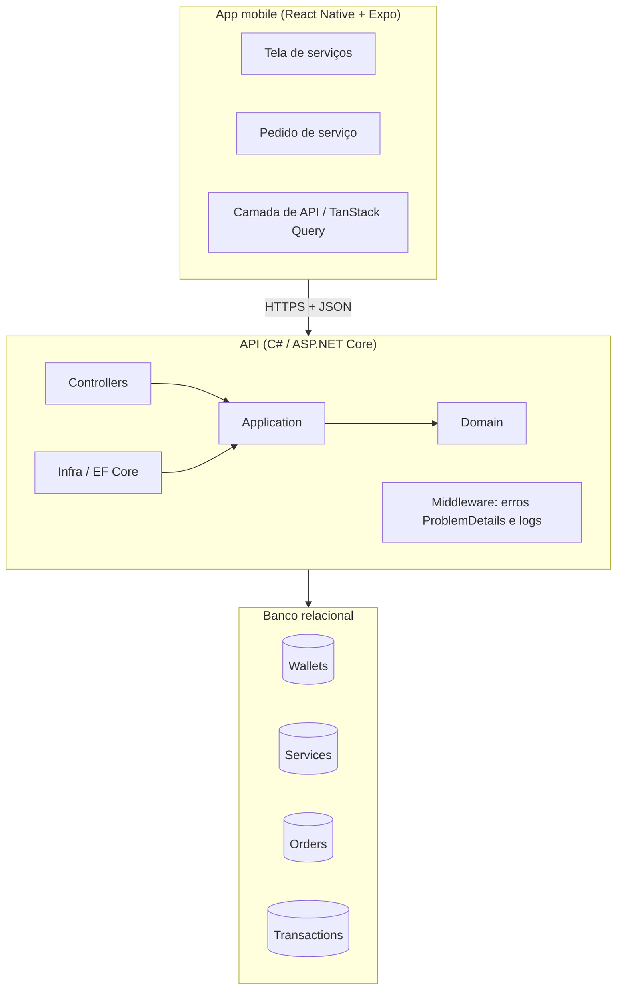
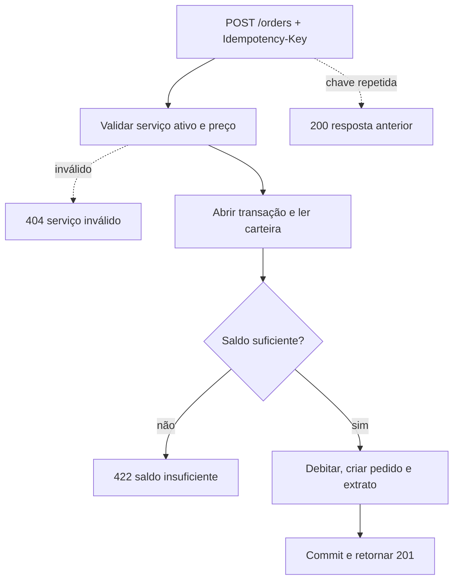

# Plano do projeto: lavanderia automatizada Cicclo

Aplicação mobile simples que representa parte do fluxo de uma lavanderia automatizada: o usuário vê os serviços disponíveis e solicita um deles pagando com o saldo da carteira digital.

- **App:** React Native + Expo (TypeScript)
- **Backend:** C# / .NET (ASP.NET Core Web API)
- **Comunicação:** API HTTP/JSON
- **Foco da avaliação:** como o problema é interpretado, que decisões são tomadas e o que é testado (e por quê). Não se busca uma aplicação completa nem uma interface elaborada.

---

## 1. Cenário e regras de negócio

| Item | Valor |
|---|---|
| Saldo inicial da carteira | R$ 50,00 |
| Lavagem | R$ 18,90 |
| Secagem | R$ 20,90 |

Cenário de referência (usado nos testes): Lavagem leva o saldo a 31,10; Secagem leva a 10,20; uma nova Lavagem falha por saldo insuficiente (10,20 < 18,90) sem alterar o saldo.

Regras:

1. O saldo nunca fica negativo. Saldo exatamente igual ao preço permite a compra.
2. Débito, criação do pedido e registro no extrato acontecem na mesma transação (tudo ou nada).
3. O preço cobrado fica gravado no pedido (`PriceAtPurchase`), pois o preço do serviço pode mudar depois.
4. Retentativas da mesma intenção de compra não podem cobrar duas vezes (idempotência).
5. Dois pedidos simultâneos não podem gastar o mesmo saldo duas vezes (concorrência).
6. Toda regra de dinheiro vive no backend. O app apenas exibe e dispara ações. Desabilitar o botão por saldo insuficiente é só conveniência de UX; a decisão final é do servidor.

---

## 2. Visão de arquitetura



Responsabilidades:

- **App:** exibe saldo e serviços, gera a `Idempotency-Key`, envia o pedido e trata os erros por `code`.
- **Controllers:** rotas e DTOs HTTP, apenas mapeamento.
- **Application:** orquestra os casos de uso (ex.: solicitar serviço).
- **Domain:** regras puras (a carteira sabe se pode debitar). Sem dependências externas.
- **Infra:** EF Core, repositórios, unit of work, seed.

### Fluxo do `POST /orders`



---

## 3. Contrato da API

### Convenções

- Base path: `/api/v1`. JSON em `camelCase`.
- Valores monetários em reais com 2 casas (`18.90`), sempre com `"currency": "BRL"`. No backend são `decimal`. (Alternativa, se quiser eliminar qualquer risco de ponto flutuante no cliente: trafegar centavos como inteiro.)
- Datas em ISO 8601 UTC.
- Sem autenticação nesta versão: a API assume o usuário único criado por seed.
- Erros seguem `ProblemDetails` (RFC 7807) com um campo extra `code` estável, para o app decidir comportamento e mensagem pelo código, não pelo texto.

### `GET /wallet`

**200 OK**
```json
{
  "id": "5b1f0c1e-7a34-4c53-9c0e-2f6f4a1d9a10",
  "balance": 50.00,
  "currency": "BRL"
}
```

### `GET /services`

Lista os serviços ativos.

**200 OK**
```json
{
  "items": [
    { "id": 1, "name": "Lavagem",  "price": 18.90, "currency": "BRL" },
    { "id": 2, "name": "Secagem", "price": 20.90, "currency": "BRL" }
  ]
}
```

### `POST /orders`

Solicita a execução de um serviço, debitando a carteira.

| Header | Obrigatório | Descrição |
|---|---|---|
| `Idempotency-Key` | sim | UUID gerado pelo app por intenção de compra e reaproveitado em retentativas |
| `Content-Type` | sim | `application/json` |

**Request**
```json
{ "serviceId": 1 }
```

**201 Created** (header `Location: /api/v1/orders/{id}`)
```json
{
  "id": "0d9a6f52-3c1b-4d52-8f0a-6e1b7c2a4e11",
  "serviceId": 1,
  "serviceName": "Lavagem",
  "price": 18.90,
  "currency": "BRL",
  "status": "Confirmed",
  "createdAt": "2026-11-10T14:32:10Z",
  "walletBalance": 31.10
}
```

`walletBalance` permite ao app atualizar o saldo sem uma segunda chamada.

**200 OK (replay):** mesma `Idempotency-Key` e mesmo payload devolvem o pedido original, com o header `Idempotent-Replayed: true`, sem novo débito.

**Erros**

| Status | `code` | Quando |
|---|---|---|
| 400 | `missing_idempotency_key` | Header ausente ou não é UUID |
| 400 | `validation_error` | Corpo inválido (`serviceId` ausente ou não numérico) |
| 404 | `service_not_found` | Serviço inexistente ou inativo |
| 422 | `insufficient_balance` | Saldo menor que o preço |
| 422 | `idempotency_key_mismatch` | Mesma chave usada com outro `serviceId` |
| 409 | `wallet_conflict` | Conflito de concorrência na carteira; o cliente pode retentar com a mesma chave |

**Exemplo de erro (422)**
```json
{
  "type": "https://cicclo.app/errors/insufficient-balance",
  "title": "Saldo insuficiente",
  "status": 422,
  "detail": "O saldo da carteira não cobre o valor do serviço.",
  "code": "insufficient_balance",
  "balance": 10.20,
  "required": 18.90
}
```

### `GET /orders` (opcional)

Histórico do usuário, do mais recente para o mais antigo.

```json
{
  "items": [
    {
      "id": "0d9a6f52-3c1b-4d52-8f0a-6e1b7c2a4e11",
      "serviceId": 1,
      "serviceName": "Lavagem",
      "price": 18.90,
      "currency": "BRL",
      "status": "Confirmed",
      "createdAt": "2026-11-10T14:32:10Z"
    }
  ]
}
```

### DTOs em C#

```csharp
public sealed record WalletResponse(Guid Id, decimal Balance, string Currency);

public sealed record ServiceResponse(int Id, string Name, decimal Price, string Currency);
public sealed record ServiceListResponse(IReadOnlyList<ServiceResponse> Items);

public sealed record CreateOrderRequest(int ServiceId);

public sealed record OrderResponse(
    Guid Id,
    int ServiceId,
    string ServiceName,
    decimal Price,
    string Currency,
    string Status,
    DateTime CreatedAt,
    decimal? WalletBalance); // preenchido apenas no POST

public sealed record OrderListResponse(IReadOnlyList<OrderResponse> Items);
```

### Decisões do contrato

- **422 para saldo insuficiente**, não 400 nem 402: a requisição é válida e entendida, mas a regra de negócio a rejeita. O 409 fica para conflito de concorrência, transitório e retentável.
- **`code` estável** no erro: o texto de `detail` pode mudar sem quebrar o cliente.
- **`Idempotency-Key` em header**, não no corpo: convenção de APIs de pagamento; mantém o payload focado no domínio.
- **Preço devolvido no pedido** reflete o valor cobrado na compra (`PriceAtPurchase`).

---

## 4. Modelo de dados

| Tabela | Campos principais |
|---|---|
| `Wallets` | `Id`, `UserId`, `Balance` (`decimal(18,2)`), `Version` (Guid, concurrency token) |
| `Services` | `Id`, `Name`, `Price`, `Active` |
| `Orders` | `Id`, `WalletId`, `ServiceId`, `PriceAtPurchase`, `Status`, `IdempotencyKey` (índice único), `CreatedAt` |
| `Transactions` | `Id`, `WalletId`, `Type` (débito), `Amount`, `BalanceAfter`, `OrderId` |

- Os serviços ficam em tabela, não fixos no código, para a lavanderia poder ganhar novos serviços sem mudar a lógica.
- `Transactions` é o extrato (ledger): o saldo sempre pode ser explicado e auditado.
- Dinheiro é sempre `decimal`, nunca `double`.
- Seed: um usuário, uma carteira com R$ 50,00 e os dois serviços.

### Consistência

1. **Atomicidade:** débito + pedido + extrato na mesma transação.
2. **Saldo nunca negativo:** `Wallet.Debit(amount)` lança erro de domínio se o saldo for menor que o valor.
3. **Concorrência:** `Version` (Guid) configurado como concurrency token no EF. O domínio troca o valor a cada débito e o `UPDATE` só passa se a versão lida ainda for a atual. Em conflito, ocorre `DbUpdateConcurrencyException`, traduzida para 409 `wallet_conflict`. (SQLite não gera `rowversion` sozinho como o SQL Server, por isso a coluna manual.)
4. **Idempotência:** índice único em `IdempotencyKey`. Chave repetida com o mesmo `serviceId` devolve o resultado anterior; com outro `serviceId`, 422 `idempotency_key_mismatch`.

---

## 5. Backend

### Plataforma

- .NET LTS atual (ASP.NET Core Web API com controllers). Confirmar com `dotnet --version` e fixar no `global.json` e no `TargetFramework`.
- Controllers em vez de Minimal APIs para deixar a separação de camadas mais visível.

### Pacotes de runtime

| Projeto | Pacote | Para quê |
|---|---|---|
| `Infrastructure` | `Microsoft.EntityFrameworkCore.Sqlite` | ORM e banco, sem instalar nada na máquina de quem avalia |
| `Api` | `Microsoft.EntityFrameworkCore.Design` | Migrations (`PrivateAssets=all`) |
| `Api` | `Microsoft.AspNetCore.OpenApi` | Documento OpenAPI com o contrato |
| `Api` | `Scalar.AspNetCore` (opcional) | UI para testar endpoints (alternativa: `Swashbuckle.AspNetCore`) |

Ferramenta global: `dotnet tool install --global dotnet-ef`.

Já vem no framework, sem pacote: `ProblemDetails` (`AddProblemDetails()` + `IExceptionHandler`), validação por DataAnnotations (o corpo tem um único campo), DI, configuração, logging e health checks.

### Pacotes que escolho não usar

- **MediatR e AutoMapper:** desnecessários neste tamanho e com licenciamento comercial. O caso de uso é uma classe injetada; o mapeamento é manual, com `record`s.
- **Mocks (Moq, NSubstitute):** testo contra SQLite real. Mocks de repositório não provariam atomicidade nem concorrência, que são os pontos de risco.
- **FluentAssertions:** a partir da v8 tem licença comercial. Uso asserções do xUnit ou `Shouldly`.

### Pacotes de teste

| Pacote | Para quê |
|---|---|
| `xunit` + `xunit.runner.visualstudio` | Framework de testes |
| `Microsoft.NET.Test.Sdk` | Execução via `dotnet test` |
| `Microsoft.AspNetCore.Mvc.Testing` | `WebApplicationFactory` para integração |
| `Microsoft.EntityFrameworkCore.Sqlite` | Banco real nos testes |
| `Shouldly` (opcional) | Asserções legíveis |
| `coverlet.collector` (opcional) | Cobertura |

Nos testes de integração uso **SQLite em memória com uma conexão compartilhada e mantida aberta**, não o provider `InMemory` do EF: o `InMemory` não suporta transações reais nem controle de concorrência, e são exatamente esses comportamentos que quero validar.

### Comandos para criar a base

```bash
dotnet new sln -n Cicclo
dotnet new classlib -o src/Cicclo.Domain
dotnet new classlib -o src/Cicclo.Application
dotnet new classlib -o src/Cicclo.Infrastructure
dotnet new webapi --use-controllers -o src/Cicclo.Api
dotnet new xunit -o tests/Cicclo.Domain.Tests
dotnet new xunit -o tests/Cicclo.Api.Tests

dotnet add src/Cicclo.Infrastructure package Microsoft.EntityFrameworkCore.Sqlite
dotnet add src/Cicclo.Api package Microsoft.EntityFrameworkCore.Design
dotnet add src/Cicclo.Api package Scalar.AspNetCore
dotnet add tests/Cicclo.Api.Tests package Microsoft.AspNetCore.Mvc.Testing
dotnet add tests/Cicclo.Api.Tests package Microsoft.EntityFrameworkCore.Sqlite
dotnet add tests/Cicclo.Api.Tests package Shouldly
```

`dotnet add package` resolve a versão estável mais recente compatível. Alternativa ao SQLite: PostgreSQL (`Npgsql.EntityFrameworkCore.PostgreSQL`) com Docker Compose e a coluna `xmin` como concurrency token; para o escopo do desafio, o SQLite reduz atrito.

### Referências entre projetos

```
Cicclo.Domain          (sem dependências)
Cicclo.Application     → Domain
Cicclo.Infrastructure  → Application, Domain  (+ EF Core Sqlite)
Cicclo.Api             → Application, Infrastructure
Cicclo.Domain.Tests    → Domain
Cicclo.Api.Tests       → Api  (+ Mvc.Testing)
```

O `Domain` sem pacote algum é intencional: a regra de saldo não depende de infraestrutura e é testável de forma puramente unitária.

---

## 6. App mobile (Expo)

- Expo + TypeScript, uma única tela: saldo no topo, lista de serviços e botão "Solicitar" com confirmação.
- TanStack Query para buscar dados e para a mutation do pedido; após o sucesso, invalidar a query do saldo.
- Botão desabilitado durante a requisição para evitar duplo toque.
- A `Idempotency-Key` (UUID) é gerada por intenção de compra e reaproveitada em retentativas.
- Mensagens de erro decididas pelo `code` retornado pela API.
- Configuração da URL da API via `EXPO_PUBLIC_API_URL`.

---

## 7. Estrutura do repositório (Clean Architecture)

Monorepo com `backend/` e `mobile/` lado a lado. Cada lado tem seu próprio toolchain (`dotnet` e `npm`), sem workspace compartilhado: as stacks não compartilham código. O que as liga é o contrato OpenAPI.

```
cicclo-laundry/
├── README.md                     # como rodar, decisões, o que ficou de fora
├── plan.md                       # este documento
├── docs/
│   ├── architecture.md           # diagramas e decisões
│   └── openapi.yaml              # contrato da API (fonte única)
├── docker-compose.yml            # opcional: sobe a API com um comando
├── .gitignore
├── .editorconfig
│
├── backend/
│   ├── Cicclo.sln
│   ├── global.json               # fixa a versão do SDK
│   ├── Directory.Build.props     # Nullable, TreatWarningsAsErrors, LangVersion
│   ├── Directory.Packages.props  # versões centralizadas dos pacotes
│   │
│   ├── src/
│   │   ├── Cicclo.Domain/
│   │   │   ├── Wallets/
│   │   │   │   ├── Wallet.cs                 # Debit(), regra de saldo, Version
│   │   │   │   └── WalletTransaction.cs      # extrato (ledger)
│   │   │   ├── Services/
│   │   │   │   └── LaundryService.cs         # Name, Price, Active
│   │   │   ├── Orders/
│   │   │   │   ├── Order.cs
│   │   │   │   └── OrderStatus.cs
│   │   │   ├── Exceptions/
│   │   │   │   └── InsufficientBalanceException.cs
│   │   │   └── Common/
│   │   │       └── Money.cs                  # opcional (value object)
│   │   │
│   │   ├── Cicclo.Application/
│   │   │   ├── Abstractions/                 # portas implementadas pela Infra
│   │   │   │   ├── IWalletRepository.cs
│   │   │   │   ├── IServiceRepository.cs
│   │   │   │   ├── IOrderRepository.cs
│   │   │   │   └── IUnitOfWork.cs
│   │   │   ├── Wallets/GetWallet/
│   │   │   │   ├── GetWalletUseCase.cs
│   │   │   │   └── WalletResult.cs
│   │   │   ├── Services/ListServices/
│   │   │   ├── Orders/
│   │   │   │   ├── CreateOrder/
│   │   │   │   │   ├── CreateOrderUseCase.cs
│   │   │   │   │   ├── CreateOrderCommand.cs
│   │   │   │   │   └── CreateOrderResult.cs
│   │   │   │   └── ListOrders/
│   │   │   ├── Errors/ApplicationErrors.cs   # ServiceNotFound, KeyMismatch...
│   │   │   └── DependencyInjection.cs
│   │   │
│   │   ├── Cicclo.Infrastructure/
│   │   │   ├── Persistence/
│   │   │   │   ├── AppDbContext.cs
│   │   │   │   ├── Configurations/           # IEntityTypeConfiguration por entidade
│   │   │   │   ├── Migrations/
│   │   │   │   ├── Repositories/
│   │   │   │   ├── UnitOfWork.cs
│   │   │   │   └── Seed/DbSeeder.cs          # carteira R$ 50 + 2 serviços
│   │   │   └── DependencyInjection.cs
│   │   │
│   │   └── Cicclo.Api/
│   │       ├── Controllers/
│   │       │   ├── WalletController.cs
│   │       │   ├── ServicesController.cs
│   │       │   └── OrdersController.cs
│   │       ├── Contracts/                    # DTOs HTTP (request/response)
│   │       ├── Middleware/
│   │       │   └── GlobalExceptionHandler.cs # exceções → ProblemDetails + code
│   │       ├── Program.cs                    # composition root
│   │       ├── appsettings.json
│   │       └── Properties/launchSettings.json
│   │
│   └── tests/
│       ├── Cicclo.Domain.Tests/
│       │   └── Wallets/WalletDebitTests.cs
│       ├── Cicclo.Application.Tests/         # opcional
│       └── Cicclo.Api.Tests/
│           ├── Infrastructure/ApiFactory.cs  # WebApplicationFactory + SQLite em memória
│           ├── CreateOrderTests.cs           # cenário do enunciado, 422, 404
│           ├── IdempotencyTests.cs
│           └── ConcurrencyTests.cs
│
└── mobile/
    ├── package.json
    ├── app.json
    ├── tsconfig.json
    ├── babel.config.js
    ├── jest.config.js
    ├── .env.example              # EXPO_PUBLIC_API_URL
    │
    ├── app/                      # Expo Router: só roteamento, sem lógica
    │   ├── _layout.tsx           # providers (QueryClient)
    │   └── index.tsx             # tela única, delega para a feature
    │
    └── src/
        ├── domain/               # tipos e regras puras, sem React nem HTTP
        │   ├── wallet.ts
        │   ├── laundryService.ts
        │   ├── order.ts
        │   └── errors.ts         # códigos de erro (insufficient_balance...)
        │
        ├── application/          # casos de uso e portas
        │   ├── ports/LaundryGateway.ts       # interface que a infra implementa
        │   └── useCases/
        │       ├── getWallet.ts
        │       ├── listServices.ts
        │       └── requestService.ts         # gera Idempotency-Key, chama gateway
        │
        ├── infrastructure/
        │   ├── http/httpClient.ts            # fetch/axios + parse de ProblemDetails
        │   ├── api/LaundryApiGateway.ts      # implementa LaundryGateway
        │   └── config/env.ts
        │
        ├── presentation/
        │   ├── screens/ServicesScreen.tsx
        │   ├── components/
        │   │   ├── BalanceCard.tsx
        │   │   ├── ServiceItem.tsx
        │   │   └── ConfirmDialog.tsx
        │   ├── hooks/                        # TanStack Query: useWallet, useRequestService
        │   └── formatters/currency.ts
        │
        ├── di/container.ts       # composition root: liga gateway aos casos de uso
        │
        └── __tests__/
            ├── requestService.test.ts
            └── ServicesScreen.test.tsx
```

### Regra de dependência

```
Backend:  Api → Application → Domain
          Infrastructure → Application → Domain
          (Api referencia Infrastructure só para registrar no DI)

Mobile:   presentation → application → domain
          infrastructure → application → domain
          di liga tudo
```

As setas apontam para dentro. O `Domain` não conhece ninguém; o `Application` define as interfaces (`IWalletRepository`, `LaundryGateway`) e a `Infrastructure` as implementa. Assim a regra de saldo e o caso de uso "solicitar serviço" são testáveis sem banco e sem rede.

### Decisões de estrutura

- **Casos de uso por pasta** (`CreateOrder/`), não por camada técnica: o fluxo inteiro fica em um lugar. Sem MediatR; o caso de uso é uma classe injetada no controller.
- **`Contracts/` na Api separado dos resultados da Application:** o JSON pode evoluir sem contaminar a camada de aplicação.
- **`Directory.Packages.props`:** versões centralizadas, sem divergência entre produção e testes.
- **`app/` fino no mobile:** o Expo Router exige a pasta para rotear, mas as telas reais ficam em `presentation/`; a navegação pode mudar sem afetar a lógica.
- **`LaundryGateway` como porta:** o teste de `requestService` usa um gateway falso, sem mockar `fetch` (mesma ideia do `IWalletRepository`).
- **`docs/openapi.yaml` como fonte do contrato.** Opcionalmente, gerar tipos TypeScript com `openapi-typescript`; para o escopo, tipos manuais em `domain/` bastam.

Clean Architecture completa para três endpoints é intencionalmente um pouco mais do que o problema exige: o objetivo é demonstrar separação onde ela traz benefício real (regra de saldo isolada e testável, persistência trocável, app independente do formato HTTP). Se o tempo apertar, simplificar primeiro `Cicclo.Application.Tests` (coberto pelos testes de integração) e o value object `Money`; preservar o `Domain` puro, os casos de uso e as portas.

---

## 8. Estratégia de testes

Não se espera cobertura total. O critério é testar onde está o risco e explicar o porquê.

| Nível | O que testar | Por quê |
|---|---|---|
| Unitário do domínio (xUnit) | Débito com saldo suficiente, saldo exato, saldo insuficiente; saldo inalterado quando o débito falha | É onde está o risco financeiro e é barato de testar |
| Integração da API (`WebApplicationFactory` + SQLite em memória) | Cenário do enunciado de ponta a ponta (50,00 → 31,10 → 10,20 → 422 sem alterar saldo); 404 para serviço inválido | Prova o fluxo completo, a transação e o mapeamento de erros |
| Idempotência | Mesma chave enviada duas vezes gera um único débito; mesma chave com outro serviço retorna 422 | Protege contra cobrança dupla em retentativas de rede |
| Concorrência | Requisições paralelas nunca deixam o saldo negativo | Garante a regra sob corrida |
| App (React Native Testing Library) | Tela exibe os serviços e trata o erro de saldo insuficiente; `requestService` com gateway falso | Valida o comportamento visível e o caso de uso sem rede |

Fora dos testes de propósito: estilo e navegação (pouco valor neste escopo).

---

## 9. Ordem de desenvolvimento

1. **Domínio e testes unitários:** `Wallet.Debit`, `InsufficientBalanceException`, concurrency token `Version`.
2. **Persistência:** EF Core, configurações, migrations e seed (carteira R$ 50,00 e os dois serviços).
3. **Casos de uso e endpoints:** `GetWallet`, `ListServices`, `CreateOrder`, controllers e middleware de erros (`ProblemDetails` + `code`).
4. **Testes de integração:** cenário do enunciado, idempotência e concorrência.
5. **App Expo** conectado à API: tela única, mutation do pedido, tratamento de erros.
6. **Documentação:** `docs/openapi.yaml`, `docs/architecture.md` e README (como rodar, decisões tomadas, o que ficou de fora).

### Estado da wallet

- Concluído: regras e testes unitários de débito/crédito, persistência SQLite com migrations e seed de R$ 50,00, `GET /api/v1/wallet`, crédito idempotente em `POST /api/v1/wallet/credits` e testes de integração.
- Concluído nesta etapa: tabelas e seed de serviços, `GET /api/v1/services` (somente serviços ativos), `POST /api/v1/orders`, débito/pedido/extrato atômicos, replay idempotente, proteção de saldo sob concorrência e testes de integração.
- Pendente para as próximas etapas do plano: histórico opcional de pedidos, integração mobile e documentação OpenAPI/arquitetura completa.

### Checklist de entrega

- [x] Backend roda com um comando (`dotnet run`) e aplica migrations/seed
- [x] `dotnet test` passa
- [ ] App abre, lista serviços e saldo, e solicita um serviço
- [ ] Erro de saldo insuficiente aparece de forma amigável
- [ ] README explica como rodar, as decisões e o que ficou de fora
- [ ] Contrato OpenAPI refletindo a API real

---

## 10. Fora do escopo (a mencionar no README)

- Integração real com a máquina, que exigiria os status `Pending → Running → Done` e um fluxo assíncrono ou webhook.
- Recarga de saldo e estorno em caso de falha da máquina.
- Autenticação com JWT.
- Observabilidade e paginação.