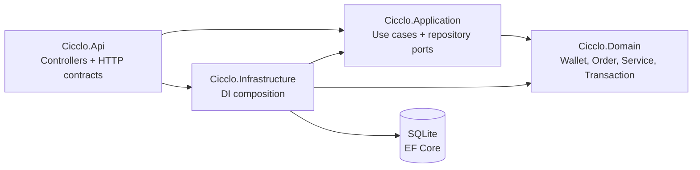
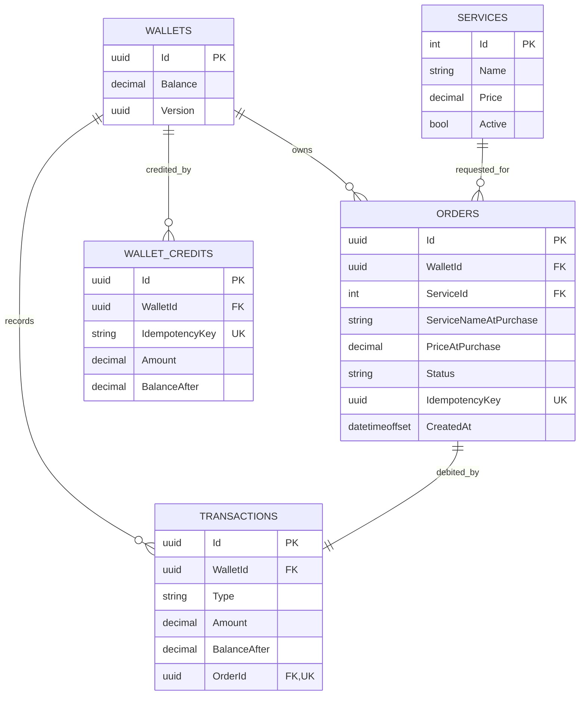

# Cicclo backend architecture

## Scope and runtime

The backend is an ASP.NET Core Web API targeting .NET 10. It uses controllers under `/api/v1`, application use cases, a domain model, and EF Core with SQLite. The API applies EF migrations and seeds the default wallet plus the Lavagem and Secagem services during startup. OpenAPI and Scalar are exposed in Development.

Authentication and JWT are not implemented. The current API is a single-user demonstration: order creation, wallet credits, and transaction history operate on the default wallet. Wallet lookup by ID is available, but does not establish ownership or authorization.

## Dependency direction

- **API** maps HTTP input/output and status codes. It does not expose EF entities.
- **Application** coordinates use cases and defines repository interfaces.
- **Domain** contains wallet credit/debit rules and order/transaction types.
- **Infrastructure** implements repositories, EF mappings, migrations, and seed data.

## Main request flows

### Requesting a service

1. `POST /api/v1/orders` validates the request and parses `Idempotency-Key`.
2. The order repository opens a serializable SQLite transaction.
3. It checks for an earlier order using the key, then checks that the service is active.
4. It loads the default wallet and checks/debits its balance.
5. On success it writes the order and debit ledger entry in the same transaction, then commits.
6. A retry with the same key and service returns the original order without a second debit. A mismatch returns `422`; insufficient funds returns `422`; a transient concurrency conflict returns `409`.

The order stores the service name and price as purchased, so later service edits do not rewrite order history. `Wallet.Version` is an optimistic concurrency token. Failed requests do not create an order or ledger entry.

### Wallet credits

`POST /api/v1/wallet/credits` stores idempotent wallet credits in the `WalletCredits` table with the balance update in a transaction. These records are separate from the `Transactions` debit ledger and therefore are not currently returned by `GET /api/v1/wallet/transactions`.

## Data model

Money uses .NET `decimal`, persisted with precision `(18,2)`. The default wallet starts at R$ 50,00; seeded active services are Lavagem (R$ 18,90) and Secagem (R$ 20,90).

## HTTP surface

- `GET /api/v1/wallet` and `GET /api/v1/wallet/{id}`
- `POST /api/v1/wallet/credits`
- `GET /api/v1/wallet/transactions`
- `GET /api/v1/services` and `GET /api/v1/services/{id}`
- `GET /api/v1/orders`, `GET /api/v1/orders/{id}`, and `POST /api/v1/orders`

The canonical request/response definitions and error codes are in [openapi.yaml](./openapi.yaml). List endpoints are not paginated; pagination and observability are outside the current project scope.

## Tests

Domain tests exercise wallet balance rules. API integration tests use `WebApplicationFactory` and SQLite in-memory with a shared open connection, so migrations, persistence, transactions, idempotency, and concurrent requests run against a relational provider.
